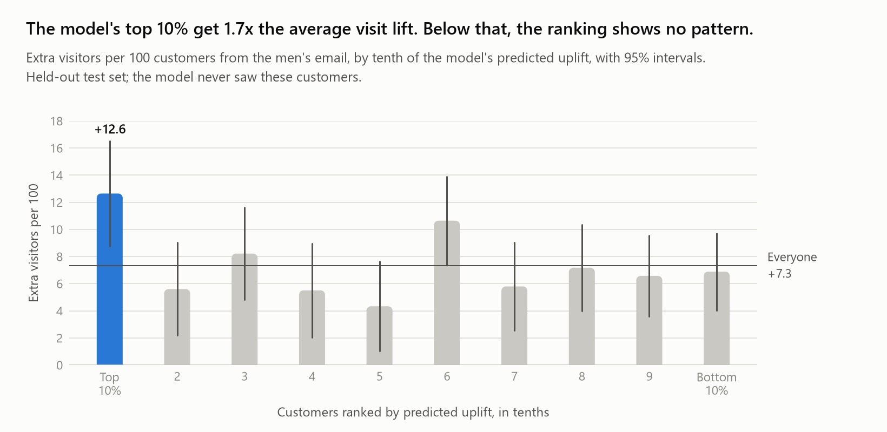
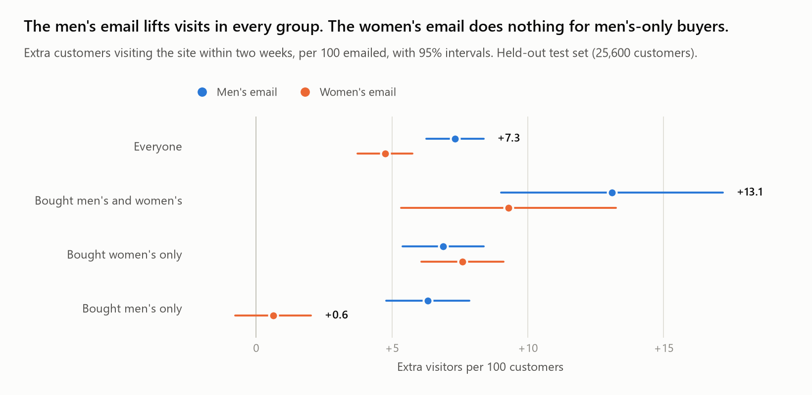
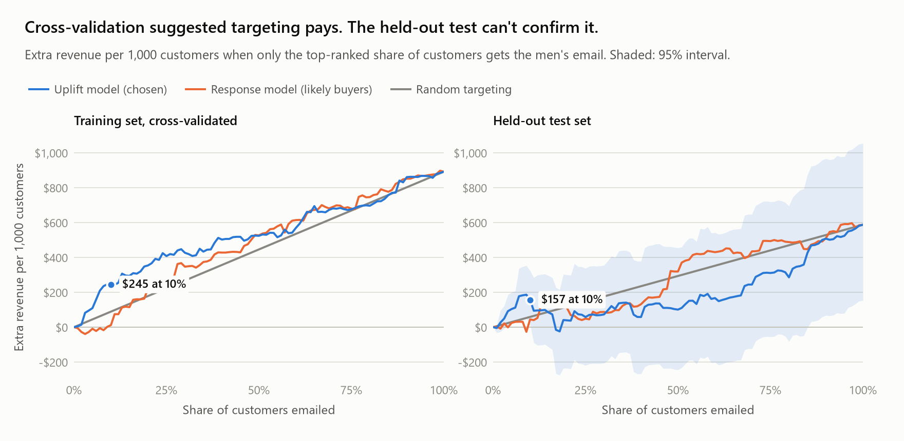
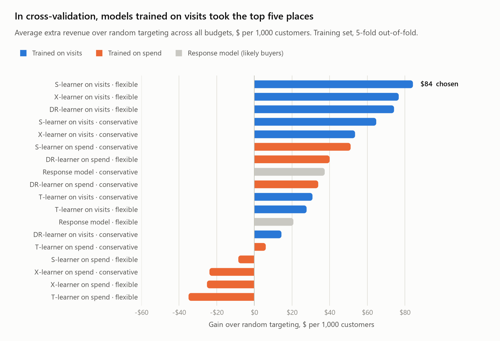
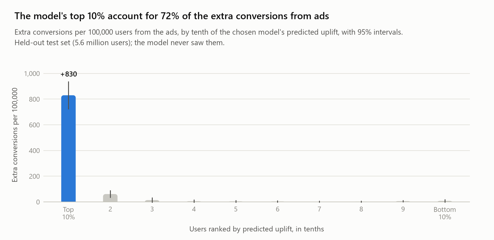
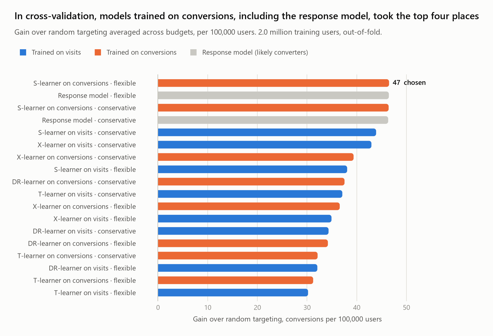

# Who should get the email?

[](https://github.com/chensirui3/uplift-targeting/actions/workflows/tests.yml)

**Uplift modeling on a randomized experiment with 64,000 customers: who changes their behavior *because of* a promotion, and is it worth targeting them?**

A retailer emailed its recent customers at random. A third got an email featuring men's merchandise, a third got one featuring women's merchandise, and a third got nothing. Two weeks later it recorded who visited the site, who bought, and how much they spent ([Kevin Hillstrom's MineThatData e-mail challenge](http://www.minethatdata.com/Kevin_Hillstrom_MineThatData_E-MailAnalytics_DataMiningChallenge_2008.03.20.csv), 2008). Because the groups were random, the data can answer a causal question that a "who will buy?" model can't: whose behavior does the email change? The same question applies to any promotion, a coupon included.

## The answer

- **Send the men's email to everyone, and drop the women's email.** The men's email more than doubles spend per customer (+$0.77, 95% CI $0.49 to $1.05). At a 30% margin, emailing everyone pays as long as an email costs less than about $0.23. The women's email is weaker overall and does nothing for customers who only buy men's items.
- **An uplift model does find the customers who respond most, but the difference only shows up in visits.** On customers the model never saw, the email's effect on visits among its top 10% was 1.7 times the average (+12.6 vs +7.3 extra visitors per 100). These are mostly people who buy both men's and women's items. Ranking customers by how likely they are to buy found no one special.
- **In dollars, no targeting model beat random targeting on held-out data, and this test was too small to tell.** Cross-validation suggested the chosen model would earn about $156 more per 1,000 customers than random targeting at a 10% budget. The test set can only reliably detect gains above $211. Confirming it would take about 1.8 times as many test customers (4.1 times at a 30% budget).

The most useful lesson is the last one. When fewer than 1 customer in 100 buys, a model can look clearly better in cross-validation and still be unproven on new customers. Measuring that honestly is what decides whether targeting is worth paying for. A [replication on 14 million users](#replication-on-14-million-users-criteo) from Criteo's ad experiments is big enough to settle the question there. Targeting clearly beats random, and with that much data, training on the outcome that matters works as well as training on visits.

**[Try the interactive demo →](https://chensirui3.github.io/uplift-targeting/)** Set what an email costs and the margin, pick how many customers to email, and compare the model's picks with random targeting, with every 95% interval shown. A second section does the same for the Criteo replication, where targeting clearly beats random, with each estimate as randomized and reweighted.

<picture>
  <source media="(prefers-color-scheme: dark)" srcset="figures/deciles_visits-dark.png">
  
</picture>

## Findings

### 1. The men's email works for everyone; the women's email adds nothing

Effect of each email, all 64,000 customers, with 95% confidence intervals:

| | Visited the site | Bought something | Spend per customer |
|---|---|---|---|
| No email (baseline) | 10.6% | 0.57% | $0.65 |
| Men's email | +7.7 points (7.0 to 8.3), +72% | +0.68 points (0.50 to 0.86), +119% | +$0.77 ($0.49 to $1.05), +118% |
| Women's email | +4.5 points (3.9 to 5.2), +43% | +0.31 points (0.15 to 0.47), +54% | +$0.42 ($0.17 to $0.68), +65% |

<picture>
  <source media="(prefers-color-scheme: dark)" srcset="figures/which_email-dark.png">
  
</picture>

On held-out customers, the women's email raised visits among men's-only buyers by just 0.6 per 100 (CI −0.8 to +2.0). For women's-only buyers it did no better than the men's email (+7.6 vs +6.9). When the model was free to choose either email for each customer, it sent the women's email to fewer than 0.1% of the customers it targeted.

### 2. The model finds a persuadable 10%, in visits

On the held-out test set, the email's effect on visits among the model's top 10% was 1.7 times the average. Below that, the ranking shows no pattern: the other nine tenths bounce around the average without trending down (chart above). Who the top 10% are:

| | Model's top 10% | Everyone |
|---|---|---|
| Bought both men's and women's items last year | 79% | 10% |
| Months since last purchase (median) | 3 | 6 |
| Spent last year (median) | $394 | $158 |
| Buys through several channels | 30% | 12% |
| New customer this year | 61% | 50% |

The usual alternative is a response model, which ranks customers by how much they are predicted to spend if emailed. Its top 10% responded no more than a random 10% (+0.6 extra visitors per 1,000 over random, CI −2.7 to +4.0).

### 3. In dollars, the test can't tell targeting from random

<picture>
  <source media="(prefers-color-scheme: dark)" srcset="figures/cv_vs_test-dark.png">
  
</picture>

Gain over random targeting on the held-out test set, per 1,000 customers, with 95% intervals:

| Targeting by | Extra visitors, top 10% | Extra visitors, top 30% | Extra revenue, top 10% | Extra revenue, top 30% |
|---|---|---|---|---|
| Uplift model (chosen in advance) | +5.1 (1.6 to 8.8) | +4.3 (−0.9 to 9.2) | +$99 (−$39 to $256) | −$103 (−$332 to $117) |
| Two-question rule distilled from it | +3.0 (−0.5 to 6.5) | +5.3 (0.2 to 10.3) | −$16 (−$159 to $129) | −$83 (−$317 to $146) |
| Best uplift model trained on spend | +1.0 (−2.5 to 4.6) | +0.5 (−4.6 to 5.3) | −$128 (−$308 to $27) | −$69 (−$292 to $166) |
| Response model ("likely buyers") | +0.6 (−2.7 to 4.0) | −0.3 (−5.2 to 4.8) | −$14 (−$194 to $161) | −$89 (−$315 to $141) |

The revenue intervals are wide because purchases are rare (0.9% of customers) and large ($116 on average). Spend per customer is almost all zeros with occasional $100+ spikes. Even the effect of emailing *everyone* is uncertain on the test set: somewhere between $153 and $1,054 per 1,000 customers.

How much data a conclusion would need, at 80% power:

| Budget | Smallest gain this test can detect | Gain cross-validation suggested | Test customers needed |
|---|---|---|---|
| Top 10% | $211 per 1,000 | $156 per 1,000 | about 47,000 (1.8× the test set) |
| Top 30% | $321 per 1,000 | $159 per 1,000 | about 104,000 (4.1× the test set) |

These requirements are a floor. The cross-validated gains belong to the best of 16 candidate models, so they are probably optimistic.

The two-question rule is a depth-2 decision tree fit to the model's predictions. It puts customers who spent more than $202 last year and bought men's items first. It is the only targeting method here whose advantage in visits holds up across all budgets on the test set (area over random: +4.3 extra visitors per 1,000, CI 1.3 to 7.4). See [results/rule.txt](results/rule.txt).

### 4. Model on what happens often, not on what matters most

<picture>
  <source media="(prefers-color-scheme: dark)" srcset="figures/cv_ranking-dark.png">
  
</picture>

Each uplift learner was trained twice: once on spend directly, and once on visits, with the visit effect converted to dollars at the average incremental spend per incremental visit ($11.31 for the men's email). In cross-validation, the five best models were all trained on visits. Three of the four flexible models trained on spend ranked customers worse than random, because they were fitting noise. On the test set, the visit-trained model's top 10% beat the spend-trained model's top 10% by 4.1 extra visitors per 1,000 (CI roughly 0 to 8) and by $226 of revenue (CI $23 to $462). That is consistent with cross-validation, but with this many comparisons one interval shouldn't carry much weight.

## Recommendation

1. **Email everyone the men's email** while an email costs less than about $0.23 (CI $0.15 to $0.32), assuming a 30% margin on revenue:

   | All-in cost per email | Profit per 1,000 customers (95% CI) |
   |---|---|
   | $0.05 | $181 ($96 to $266) |
   | $0.10 | $131 ($46 to $216) |
   | $0.20 | $31 (−$54 to $116) |

2. **If volume is capped, start with customers who buy both men's and women's items**, then recent, high-spending ones. The evidence for them is solid in visits, not yet in revenue.
3. **Before paying for individual-level targeting, run a bigger holdout.** Use roughly 50,000 to 100,000 test customers per comparison, or measure a frequent outcome closer to revenue, such as add-to-cart.

## Replication on 14 million users (Criteo)

Hillstrom's test set was too small to say whether targeting pays (finding 3), and the case for training on visits (finding 4) rests on 38,400 training customers. Both questions can be asked again of [Criteo's uplift dataset](https://ailab.criteo.com/criteo-uplift-prediction-dataset/) (v2.1): 13,979,592 users from randomized advertising experiments, in which a random 15% of users were kept from the advertiser's ads. It records whether each user visited the advertiser's site (4.7%) and whether they converted (0.29%), but not revenue, so conversions stand in for spend. Across all users, ads raised conversions by 59% (+115 per 100,000 users, CI 108 to 122) and visits by 27%.

The protocol is Hillstrom's. The data were split 60/40. The same 18 candidates were compared by 5-fold cross-validation on training data only. The same selection rule, with conversions in place of spend, was committed and saved to [results/criteo/selection.json](results/criteo/selection.json) before the test set was scored. The chosen model was then evaluated once on 5,591,837 held-out users. The test-set stage was later rerun from the saved selection, only to add each tenth's treated share and estimated chance of treatment, and every test-set estimate reproduced exactly. Every number below comes from [results/criteo/](results/criteo).

- **Targeting beats random by a wide margin, and this time the test is big enough to show it.** The chosen model, an S-learner trained on conversions, finds 72% of the ads' extra conversions (CI 68% to 76%) in the top 10% of users. That is 71 more extra conversions per 100,000 users than a random 10% would get (CI 62 to 81). The test could have detected a gain of 14, and cross-validation had predicted 71.
- **Training on visits did not help.** On the test set, the best model trained on visits and the best trained on conversions ranked users equally well. The difference in area over random was −0.6 per 100,000 users (CI −2.4 to +1.4), while the test could have detected 2.7. Hillstrom's lesson to model the frequent outcome does not carry over to a training set with about 24,500 conversions.
- **A response model did as well as any uplift model.** Ranking users by how likely they are to convert with ads, without ever looking at the control group, matched the chosen uplift model (area over random 47.2 vs 46.6 per 100,000, difference CI −0.4 to +1.4). In Hillstrom it was no better than random.
- **Treatment is not quite independent of the features, which inflates the overall effect but not the comparisons.** Reweighting by each user's estimated chance of treatment lowers the effect of ads from 115 to 98 extra conversions per 100,000 users. Every answer above holds either way.

<picture>
  <source media="(prefers-color-scheme: dark)" srcset="figures/criteo/deciles_conversions-dark.png">
  
</picture>

### Finding 3 revisited: a test big enough to tell

<picture>
  <source media="(prefers-color-scheme: dark)" srcset="figures/criteo/cv_vs_test-dark.png">
  
</picture>

| | Hillstrom (revenue) | Criteo (conversions) |
|---|---|---|
| Held-out test set | 25,600 customers | 5,591,837 users |
| Effect of treating everyone, on the test set | $587 per 1,000 ($153 to $1,054) | 115 per 100,000 (104 to 125) |
| Chosen model's gain over random, top 10% | +$99 per 1,000 (−$39 to $256) | +71 per 100,000 (62 to 81) |
| Gain cross-validation suggested, top 10% | $156 per 1,000 | 71 per 100,000 |
| Smallest gain the test can detect, top 10% | $211 per 1,000 | 14 per 100,000 |
| Test set needed to detect the suggested gain | 1.8 times the test set | 0.04 times (about 211,000 users) |

Size is only part of the difference. Criteo's ads work almost entirely through a small group: the chosen model's top tenth gains 830 extra conversions per 100,000 users (CI 724 to 936), the second tenth 61 (34 to 88), and no other tenth more than 14. So targeting captures most of the effect, and the gain over random is large next to its noise. Cross-validation was also right this time: it predicted 71 extra conversions per 100,000 at a 10% budget, and the test found 71. On Hillstrom, it predicted $156 per 1,000, and the test found $99 with an interval too wide to confirm it.

### Finding 4 revisited: once the rare outcome is common enough, train on it

<picture>
  <source media="(prefers-color-scheme: dark)" srcset="figures/criteo/cv_ranking-dark.png">
  
</picture>

In Hillstrom's cross-validation, the five best models were all trained on visits. In Criteo's, models trained on conversions took the top four places (two of them response models). They also won 6 of the 8 like-for-like pairs, where the learner and the regularization are the same and only the training outcome differs. On the test set, the best of each family tied:

| Gain over random targeting, conversions per 100,000 users | Top 10% | Top 30% | Area over random |
|---|---|---|---|
| Best model trained on visits (S-learner, conservative) | +74.2 (65.5 to 82.7) | +71.3 (63.5 to 78.7) | +46.1 (41.3 to 50.6) |
| Best model trained on conversions (S-learner, flexible; chosen) | +71.5 (61.6 to 80.9) | +71.4 (63.4 to 78.6) | +46.6 (41.2 to 51.6) |
| Visits minus conversions (paired) | +2.7 (−2.9 to 8.6) | −0.1 (−2.5 to 2.5) | −0.6 (−2.4 to 1.4) |
| Response model (flexible) | +73.7 (64.0 to 83.1) | +71.3 (63.3 to 78.5) | +47.2 (41.9 to 52.1) |

The response model's top 10% even beat the chosen model's by 2.3 extra conversions per 100,000 (CI 0.3 to 4.3) as randomized, though not after reweighting (CI −0.9 to 2.9). Here, the users the ads move most are also the ones most likely to convert. In the chosen model's top tenth, 1.85% of users without ads converted anyway, against at most 0.12% in any other tenth. So ranking by likely conversion finds them too.

The likely reason training on visits stopped helping is volume. Hillstrom's training set held about 350 purchases, so a model of spend mostly fit noise. Criteo's full training set holds about 24,500 conversions, and even its 2-million-user cross-validation sample holds several thousand. Visits still carry their own signal. Measured in visits, the visit-trained model's top 10% gained 59 more extra visits per 100,000 users than the conversion-trained model's (CI 38 to 80). That edge did not carry over to conversions.

### Treatment is not quite independent of the features

Criteo describes v2.1 as fixing a leak in the first release and states that treatment cannot be recovered from the features. Its paper's classifier two-sample test did not reject that. With 8.4 million training users, a gradient-boosted classifier does recover it, slightly. Its cross-fitted AUC is 0.5104, where independence would give 0.5000 ± 0.0003. Most users' estimated chance of treatment lies between 84% and 90% (1st to 99th percentile), but it ranges from 71% to 98%. The largest standardized difference between the groups is 0.049, against Hillstrom's 0.014.

Users likely to convert are slightly more likely to be treated, so pooling all users overstates the effect of ads. Reweighting each user by their estimated chance of treatment lowers the test-set effect from 115 to 98 extra conversions per 100,000 users, and the visit effect from 1,022 to 741. The test set shows the same thing without any model of treatment. In the chosen model's top tenth, 86.4% of users were treated, against 84.6% to 85.0% in each of the other nine, and the ten within-tenth effects average 94, not 115. One possible cause is in Criteo's paper: to hide the true size of the effects, Criteo subsampled the data unevenly by outcome, which can produce this pattern. The data alone can't confirm it.

The comparisons barely move, because they pit models against each other on the same users. Reweighted, the chosen model's top 10% beats random by 77 extra conversions per 100,000 (CI 67 to 86) and holds 88% of the extra conversions. The visit-trained and conversion-trained models still tie (area difference −0.9, CI −2.7 to +1.0), and so do the chosen and response models (−0.5, CI −1.3 to +0.5). Absolute effects in this dataset carry an extra caveat anyway: Criteo altered the rates on purpose, so they describe this sample, not real campaigns.

### What changed from the Hillstrom protocol

- **Cross-validation on a subsample.** Fitting 18 candidates 5 times on the full 8.4-million-user training set would take hours. Cross-validation used a stratified 2-million-user subsample, and the three models it picked were refit on the full training set.
- **A Poisson bootstrap.** Hillstrom's bootstrap builds resampling counts in blocks of 250 resamples for every customer. With 5.6 million test users, one block alone would take 11 GB. Here, each user is drawn a Poisson(1) number of times in each resample, one resample at a time. There are still 2,000 resamples, shared across models so that differences are paired. A unit test checks that it gives the same spread as Hillstrom's bootstrap. For reweighted estimates, the intervals treat the estimated chance of treatment as fixed.
- **Two estimators.** Every test-set estimate is computed as randomized and reweighted, as above. The selection rule used the first, fixed in advance.
- **Conversions instead of dollars.** Models trained on visits convert their effects at 0.11 extra conversions per extra visit, the training-set ratio. Rankings don't depend on it.
- **Exposure is not used.** The file also records whether a treated user actually saw an ad. That is measured after assignment, so this analysis, like Criteo's benchmark, estimates the effect of being assigned to ads.
- **Data source.** The download link on Criteo AI Lab's page redirects to a storage host that no longer resolves (checked November 24, 2026). The pipeline downloads the same v2.1 file from [Criteo's Hugging Face organization](https://huggingface.co/datasets/criteo/criteo-uplift) and checks it against the SHA-256 that Hugging Face publishes. Its row count and rates match the figures on Criteo's page.

## How the analysis works

- **Evaluating a policy without trusting a model.** Emails were assigned at random, so the outcome of any targeting rule can be estimated directly from the data. For each email, average the outcomes of the customers who happened to receive what the rule would have sent them, then add up across emails. This is the stratified inverse-propensity estimator ([evaluation.py](uplift_targeting/evaluation.py)). A unit test checks that it is unbiased in simulation.
- **Model selection fixed before testing.** The data was split 60/40 into train and test, stratified by email and purchase. 18 candidates were compared by 5-fold cross-validation on the training set only: S-, T-, X- and DR-learners (Künzel et al. 2019; Kennedy 2023), each trained on spend or on visits at two levels of regularization, plus a response model at both levels. The rule, written down before testing: pick the uplift model with the largest area between its men's-email uplift curve and the random-targeting line. The winner was an S-learner on visits, evaluated once on the test set.
- **Uncertainty.** 2,000 bootstrap resamples drawn within each email group. Resamples are shared across models, so every difference between models gets its own interval.
- **Checks.** The randomization is balanced (largest standardized mean difference between groups: 0.014). The download is verified by checksum. 39 unit tests include learners recovering a known effect, a response model preferring "sure things" where uplift models don't, and the uplift curve matching an independent implementation (scikit-uplift).

## Limitations

- Only two weeks of outcomes. Long-run effects of email, such as unsubscribes and fatigue, aren't in the data.
- One retailer in 2008. Effects may differ for other brands and today's inboxes.
- The 30% margin and the costs per email are assumptions. The break-even cost scales with the margin.
- Converting visits to dollars assumes an extra visit is worth the same from every customer. Rankings, and so the targeting decisions, don't depend on it; only the dollar scale of predictions does.
- Many comparisons are reported (several models × 2 budgets × 2 outcomes). Treat a single interval that barely excludes zero as suggestive.
- The "buys both" pattern was first noticed in training data. It was confirmed on test customers in visits, but not in spend.
- The Criteo replication measures conversions, not revenue, on a sample whose rates Criteo altered on purpose. Its treatment is slightly predictable from the features (see above).

## Reproduce

Requires Python 3.12. On Windows:

```
git clone https://github.com/chensirui3/uplift-targeting.git
cd uplift-targeting
py -3.12 -m venv .venv
.venv\Scripts\activate
pip install -r requirements.txt
python -m uplift_targeting.run
pytest
```

On macOS or Linux, create the environment with `python3.12 -m venv .venv` and activate it with `source .venv/bin/activate`. The run downloads the data (4 MB, checksum-verified), runs everything in under two minutes, and writes every number to [results/](results) and every chart to [figures/](figures). Each number in this README comes from those files. To redraw the charts without refitting anything, run `python -m uplift_targeting.plots`.

The Criteo replication is a separate, longer run:

```
python -m uplift_targeting.criteo
```

It downloads 311 MB (checksum-verified) and takes 76 minutes on a 16-core desktop with 16 GB of memory, of which it uses about 4.5 GB. It writes every number to [results/criteo/](results/criteo) and every chart to [figures/criteo/](figures/criteo). To redraw its charts, run `python -m uplift_targeting.criteo_plots`. The selection is saved before the test set is scored. To rerun only the test-set evaluation from that saved selection, add `--reuse-selection`.

```
uplift_targeting/
  data.py          download and checksum, features, 60/40 split
  learners.py      S-, T-, X- and DR-learners, the visit proxy (visits to dollars or conversions), the response model
  evaluation.py    policy value from the randomization, uplift curves, paired bootstrap (Poisson for large data)
  modeling.py      the 18 candidates, cross-validation, the selection rule
  analysis.py      experiment checks and the one-time test-set evaluation
  plots.py         the charts, light and dark
  run.py           end-to-end pipeline
  criteo.py        the Criteo replication, end to end
  criteo_plots.py  its charts
tests/             39 unit tests, on simulated data and the committed results
results/           every number above (results/criteo/ for the replication)
figures/           every chart above (figures/criteo/ for the replication)
```

## Next steps

- Find where finding 4 flips. Rerun the Criteo comparison on training sets from 40,000 to 8 million users, to see how many conversions it takes before training on visits stops helping.
- Evaluate the Criteo models with a doubly robust estimator. It corrects for the uneven chance of treatment with less noise than reweighting alone.
- Learn the targeting rule directly from the experiment as a policy tree, rather than distilling it from a model.

## License

The code is under the [MIT License](LICENSE). The data come from Kevin Hillstrom's MineThatData e-mail challenge (2008). The pipeline downloads them from the original source, and this repository does not redistribute them.

The replication uses the [Criteo Uplift Prediction Dataset](https://ailab.criteo.com/criteo-uplift-prediction-dataset/) v2.1 (Diemert, Betlei, Renaudin and Amini, "A Large Scale Benchmark for Uplift Modeling", AdKDD 2018). Criteo licenses it under [CC BY-NC-SA 4.0](https://creativecommons.org/licenses/by-nc-sa/4.0/): attribution, non-commercial use only, and adaptations shared under the same terms. The pipeline downloads it from [Criteo's Hugging Face organization](https://huggingface.co/datasets/criteo/criteo-uplift), and this repository does not redistribute it. The numbers in [results/criteo/](results/criteo) and the charts in [figures/criteo/](figures/criteo) are computed from it.
